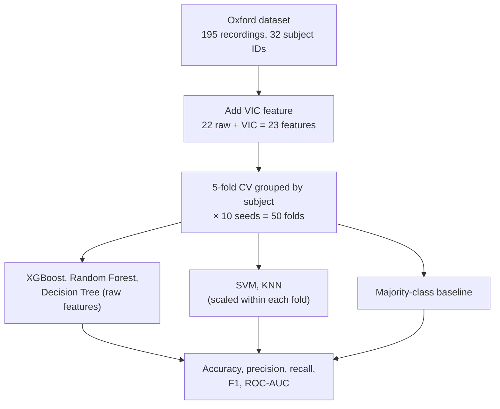
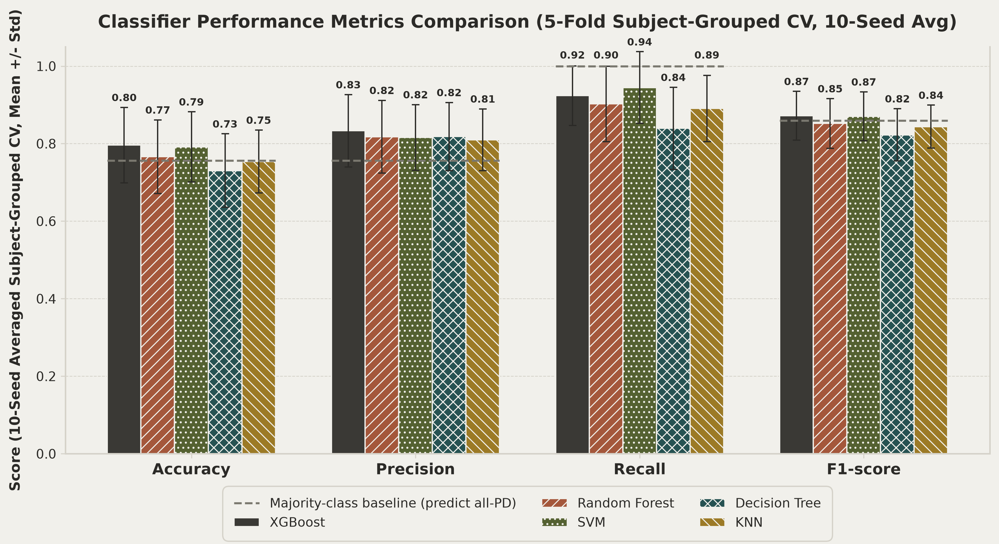
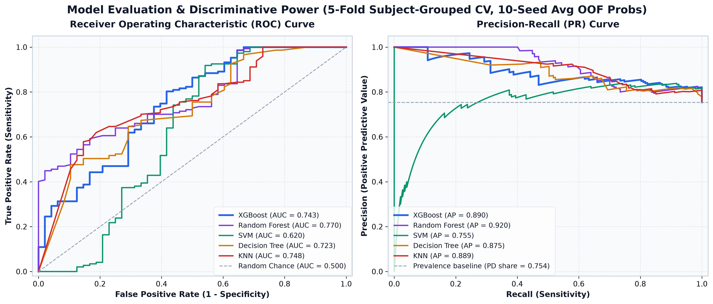

# neuroinsight-ai

**Parkinson's disease classification from voice recordings, evaluated with subject-grouped cross-validation.**

[](requirements.txt)
[](requirements.txt)
[](requirements.txt)
[](LICENSE)

Five classifiers are compared on the Oxford Parkinson's voice dataset using cross-validation **grouped by subject**, so no person's recordings appear in both training and validation. The project also proposes **VIC**, a single composite voice feature.

- **No model clearly beats the majority baseline.** The best accuracy (XGBoost, 0.796 ± 0.098) and F1 (XGBoost, 0.872 ± 0.063) sit inside the noise of the predict-everyone-has-PD baseline (accuracy 0.756 ± 0.067, F1 0.860 ± 0.043). The table below has all five models.
- **VIC alone** reaches 0.833 mean of per-fold ROC-AUC (logistic regression), versus 0.734 for all 22 raw features. These AUCs are not comparable with the table's AUCs, which pool out-of-fold predictions per seed. VIC's three parent features alone score 0.834 (same metric), so VIC compresses its ingredients rather than adding signal.
- **Row-level splits inflate scores on this dataset**, because each person has 6–7 recordings and a random split puts the same speaker in both train and test. Grouping by subject removes that.

> Research project only. Not a diagnostic tool.

## Pipeline



## Results

5-fold subject-grouped CV, mean ± std over 10 seeds:

| Model | Accuracy | Precision | Recall | F1 | ROC-AUC |
| :--- | :---: | :---: | :---: | :---: | :---: |
| *Baseline (predict all PD)* | *0.756 ± 0.067* | *0.756 ± 0.067* | *1.000 ± 0.000* | *0.860 ± 0.043* | *—* |
| **XGBoost** | **0.796 ± 0.098** | **0.833 ± 0.093** | 0.924 ± 0.077 | **0.872 ± 0.063** | 0.741 ± 0.034 |
| Random Forest | 0.766 ± 0.095 | 0.818 ± 0.094 | 0.902 ± 0.097 | 0.852 ± 0.064 | **0.764 ± 0.022** |
| SVM | 0.792 ± 0.091 | 0.816 ± 0.085 | 0.945 ± 0.092 | 0.871 ± 0.063 | 0.636 ± 0.033 |
| Decision Tree | 0.730 ± 0.095 | 0.818 ± 0.088 | 0.839 ± 0.106 | 0.823 ± 0.067 | 0.637 ± 0.052 |
| KNN | 0.754 ± 0.081 | 0.810 ± 0.080 | 0.891 ± 0.086 | 0.844 ± 0.055 | 0.715 ± 0.046 |

How to read this table:
- **XGBoost has the top accuracy and F1**, but its margins over the baseline are within fold-to-fold noise (judged from the standard deviations; no paired test was run).
- **Random Forest ranks cases best** (highest AUC), but its default decision threshold is poorly set.
- **SVM's high F1 is misleading.** Its weak AUC (0.636; Decision Tree's 0.637 is equally weak) shows the score comes from mostly predicting PD.

<p align="center">
  
  <br/>
  
  <br/>
  <em>Each recording's out-of-fold probability is averaged across the 10 seeds before both panels are drawn, so each curve's AUC differs from the per-seed average in the table, for every model (for example Decision Tree: 0.723 on the curve vs 0.637 per-seed). The dashed line in the PR panel is the prevalence baseline, 147/195 = 0.754.</em>
</p>

## VIC: Vocal Instability Compound

$$\text{VIC} = \log_{10}(\text{Jitter\%} \times \text{Shimmer:APQ3} \times \text{spread2} \times 1000)$$

VIC combines three kinds of voice instability: frequency (jitter), amplitude (shimmer), and pitch spread. In a standalone logistic-regression test with subject-grouped CV, VIC alone scored **0.833 ROC-AUC** (mean of per-fold ROC-AUC, logistic regression; not comparable with the AUCs in the results table, which pool out-of-fold predictions per seed) against **0.734** for all 22 raw features. VIC's three parent features alone (Jitter%, Shimmer:APQ3, spread2) score 0.834 on the same metric, so VIC compresses its ingredients rather than adding signal. The 22-feature model overfits at this sample size, so this doesn't show that one feature beats twenty-two. VIC is also included as a feature in all five models above.

The 0.833 / 0.734 comparison is reproduced by [`scripts/reproduce_vic.py`](scripts/reproduce_vic.py). It reports ROC-AUC as the mean of per-fold AUCs; the table above uses the AUC of pooled out-of-fold predictions per seed, so the two AUC columns are not directly comparable.

See Limitations below and [`docs/`](docs/) for the rest.

## Run it

Tested on Python 3.14; versions are pinned in `requirements.txt`.

```bash
python -m venv .venv && source .venv/bin/activate
pip install -r requirements.txt
python generate_clean_assets.py      # prints the table above, regenerates both figures
python scripts/reproduce_vic.py   # reproduces the VIC 0.833 / 0.734 comparison
```

[`notebooks/analysis.ipynb`](notebooks/analysis.ipynb) walks through the same pipeline step by step. Open it in VS Code or Jupyter.

## Repository

```
generate_clean_assets.py   full pipeline: data → VIC → grouped CV → metrics + figures
notebooks/analysis.ipynb   step-by-step walkthrough (imports the script)
scripts/reproduce_vic.py   reproduces the VIC vs raw-22 comparison (0.833 / 0.734)
data/                      Oxford dataset + two external cohorts used for validation
docs/                      VIC derivation, external validation, feature-importance checks
assets/                    figures used in this README
```

## Dataset

The data is the UCI Oxford Parkinson's Disease Detection Dataset (Little et al.). It has 195 recordings, 147 from people with PD and 48 from healthy controls. The file contains 32 subject IDs, while the UCI documentation says 31 people. Each recording has 22 acoustic features covering pitch, jitter, shimmer, noise ratios, nonlinear dynamics (D2, RPDE, DFA), and pitch entropy (spread1, spread2, PPE).

Two external datasets in `data/` are used only for the validation write-ups in `docs/`:
- `ReplicatedAcousticFeatures-ParkinsonDatabase.csv`: UCI dataset 489, Naranjo et al. ([`docs/VIC_EXTERNAL_VALIDATION.md`](docs/VIC_EXTERNAL_VALIDATION.md)).
- `parkinsons_updrs.data`: UCI Parkinson's Telemonitoring dataset, Tsanas, Little, McSharry and Ramig, University of Oxford ([`docs/VIC_TELEMONITORING_VALIDATION.md`](docs/VIC_TELEMONITORING_VALIDATION.md)).


## Limitations

- External validation is inconclusive. `spread2` is missing from both external datasets, so VIC's full formula could not be computed on either. On the Naranjo data, the two-ingredient proxy's subject-level AUC (0.628) is confounded by the missing ingredient. On the telemonitoring data, the two-ingredient VIC-2 shows a weak, statistically non-significant correlation with motor and total UPDRS at subject level (n=42; log form r=0.223 and 0.228, p>0.05). VIC is tested on the Oxford data only.
- The 22-feature model overfits at this sample size (195 rows, 32 subjects), so VIC's 0.833 vs 0.734 does not show that one feature beats twenty-two.
- SVM's F1 (0.871) comes from predicting PD for most recordings; its AUC (0.636) is weak, as is Decision Tree's (0.637).

More in [`docs/`](docs/).

## Acknowledgments

VIC was inspired by the fPI index from *"fPI: A Novel Index for Predictive Analysis of Parkinson's Disease Using Acoustic Sound Feature"* (Gupta, Bhan & Nimsarkar, IIIT Naya Raipur). VIC is independently derived and does not reuse the fPI formula. The idea of classifying the Oxford voice recordings by disease status was inspired by [bhanmrinal/fPI-Parkison-Analyser-using-Acoustic-Sound-Features](https://github.com/bhanmrinal/fPI-Parkison-Analyser-using-Acoustic-Sound-Features). No code from that repository is included here.
