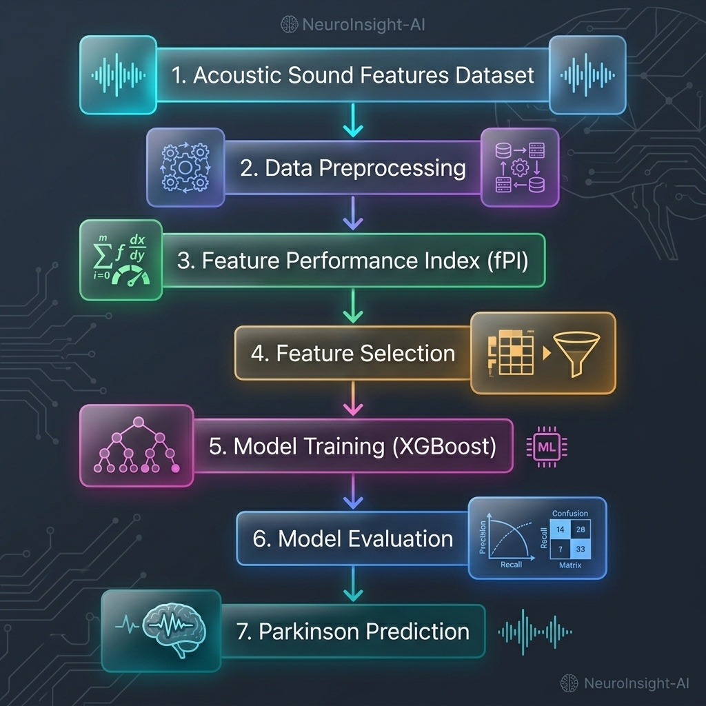

# neuroinsight-ai

### Explainable Parkinson's Disease Prediction Using Vocal Acoustics and XGBoost

[](#)
[](LICENSE)
[](#)
[](#)
[](#)
[](#)

---

## Acknowledgments & Origin

This project's feature-engineering work was inspired by **"fPI: A Novel Index for Predictive Analysis of Parkinson's Disease Using Acoustic Sound Feature"**, a paper by **Gautam Gupta, Mrinal Bhan, and Sahil Nimsarkar** at the **Data Science & AI department, International Institute of Information Technology, Naya Raipur (IIIT Naya Raipur)**, which proposed a composite acoustic index they called the **Frequency Parkinson's Indicator (fPI)**, `fPI = log10(D2 × DFA) × spread2`.

**This project does not reuse their formula.** Starting from the same idea — that a single log-product of complementary acoustic perturbation measures could compress useful signal into one feature — this project independently derived and validated a different index of its own, the **Vocal Instability Compound (VIC)**, built from a different set of ingredients with its own physiological rationale. See [Methodology — Vocal Instability Compound (VIC)](#8-methodology--vocal-instability-compound-vic) below, and [`INDEX_PROPOSAL.md`](INDEX_PROPOSAL.md) for the full derivation.

---

## 1. HERO SECTION

**neuroinsight-ai** is an applied machine learning research project exploring the non-invasive prediction of Parkinson's Disease using vocal acoustic biomarkers. Using tree-based ensemble models (**Random Forest**, **XGBoost**, and others) trained on biomedical voice measurements, alongside an independently engineered candidate feature (**VIC**, see below), this project demonstrates how structured tabular classification can detect early-stage dysphonia with high precision and interpretability.

---

## 2. PROJECT OVERVIEW & RESEARCH OBJECTIVE

Parkinson's Disease is a progressive neurodegenerative disorder characterized by the gradual loss of dopaminergic neurons. While motor symptoms like tremors and rigidity are commonly used for clinical diagnosis, vocal impairment (dysphonia) is often one of the earliest signs of the disease, appearing years before gross motor dysfunction.

Acoustic voice analysis offers a non-invasive, objective, and low-cost biomarker for identifying subtle vocal changes. The objective of this research is to investigate the predictive capability of vocal acoustic features and to compare standard classification algorithms—including Decision Trees, Support Vector Machines, Random Forests, KNN, and XGBoost—for binary classification of healthy controls vs. subjects with Parkinson's Disease.

> [!NOTE]
> This repository represents a research-oriented predictive modeling study using voice recording datasets. It is not designed, certified, or intended for clinical medical diagnosis or diagnostic product use.

---

## 3. TECHNICAL ARCHITECTURE & WORKFLOW

The predictive modeling pipeline is structured into a modular engineering workflow, starting with dataset acquisition and moving sequentially through pre-processing, classifier training, and performance benchmarking.

<div align="center">
  
</div>

### Workflow Description:
1.  **Acoustic Sound Features Dataset**: Raw vocal acoustic measurements collected from subjects containing fundamental frequency, perturbation measures, and complexity indices.
2.  **Data Preprocessing**: Feature normalization and scaling, with stratified k-fold cross-validation used for the reproducible evaluation pipeline (see §10).
3.  **Candidate Feature Engineering (VIC)**: An independently derived composite index, `VIC = log10(Jitter% × Shimmer:APQ3 × spread2 × 1000)`, validated offline on this dataset (§8) and **live in the trained pipeline** — see [Implementation Status](#implementation-status) below.
4.  **Model Training**: Fitting Decision Tree, Random Forest, SVM, KNN, and XGBoost classifiers.
5.  **Model Evaluation**: Evaluating performance using accuracy, precision, recall, and F1-score under 5-fold stratified cross-validation.
6.  **Parkinson Prediction**: Outputting classification probability and binary predictions.

---

## 4. TECH STACK

The project is built entirely on standard scientific computing libraries in Python:

*   **Language**: Python
*   **Environment**: Jupyter Notebook
*   **ML Classifiers**: XGBoost, Scikit-Learn
*   **Data Processing**: Pandas, NumPy
*   **Data Visualization**: Matplotlib, Seaborn

---

## 5. REPOSITORY STRUCTURE

The repository is structured logically to separate research documentation, datasets, and codebase modules:

```
neuroinsight-ai/
│
├── README.md                    # Project presentation and research summary
├── LICENSE                      # MIT License details
├── .gitignore                   # Python and Jupyter git exclusions
├── requirements.txt             # Package dependencies for local execution
├── generate_clean_assets.py     # Reproducible 5-fold CV script — produces the headline
│                                 # metrics table and the model_metrics/roc_pr_curves images
│
├── data/                        # Dataset directory
│   ├── pd_data.xlsx             # Excel format voice recordings dataset (used by notebooks)
│   ├── pd_data.txt              # Plaintext dataset (used by generate_clean_assets.py)
│   ├── ReplicatedAcousticFeatures-ParkinsonDatabase.csv  # Naranjo cohort (§9, VIC_EXTERNAL_VALIDATION.md)
│   └── parkinsons_updrs.data / .names  # Tsanas/Little telemonitoring cohort (§9, VIC_TELEMONITORING_VALIDATION.md)
│
├── notebooks/                   # Core research and model development
│   ├── eda.ipynb                # Exploratory data analysis, correlation & F-tests, baselines
│   ├── pd_models.ipynb          # Baseline classifiers (DT, RF, SVM, KNN)
│   └── xgboost_classifier.ipynb # Final XGBoost classification implementation
│
├── docs/                        # PDF research documentation & project files
│   └── problem_statement.pdf    # Contextual problem details
│
├── assets/                      # Image assets for documentation
│   ├── architecture.jpg         # Workflow pipeline diagram
│   ├── decision_tree.png        # Decision tree visualization
│   ├── model_metrics.png        # Classifier performance metrics comparison plot
│   └── roc_pr_curves.jpg        # ROC and Precision-Recall evaluation curves
```

Also at the repository root: **[`INDEX_PROPOSAL.md`](INDEX_PROPOSAL.md)** (how VIC was derived and validated on this dataset), **[`VIC_EXTERNAL_VALIDATION.md`](VIC_EXTERNAL_VALIDATION.md)** and **[`VIC_TELEMONITORING_VALIDATION.md`](VIC_TELEMONITORING_VALIDATION.md)** (attempted validation of VIC on two independent datasets — see [§9, External Validation & Limitations](#9-external-validation--limitations)), and **[`FEATURE_IMPORTANCE_VALIDATION.md`](FEATURE_IMPORTANCE_VALIDATION.md)** (leak-free permutation/drop-column importance validation — see [§13, Research Insights](#13-research-insights)).

---

## 6. DATASET DESCRIPTION

The analysis utilizes the UCI "Oxford Parkinson's Disease Detection Dataset" (Little et al.) — **195 voice recordings from 32 subjects** (147 recordings labeled Parkinson's, 48 labeled healthy control). The features represent different dimensions of signal perturbation, noise ratios, and nonlinear dynamics:

*   **Vocal Fundamental Frequency**: Average (`MDVP:Fo(Hz)`), maximum (`MDVP:Fhi(Hz)`), and minimum (`MDVP:Flo(Hz)`) pitch.
*   **Vocal Frequency/Amplitude Perturbation**: Jitter (`MDVP:Jitter(%)`, `MDVP:RAP`, `MDVP:PPQ`) and Shimmer (`MDVP:Shimmer`, `Shimmer:APQ3`, `Shimmer:APQ5`, `MDVP:APQ`) measures, representing variations in cycle-to-cycle frequency and amplitude.
*   **Noise Measures**: Noise-to-Harmonic Ratio (`NHR`) and Harmonic-to-Noise Ratio (`HNR`), indicating voice quality degradation.
*   **Nonlinear Dynamics**: Correlation dimension (`D2`) and Recurrence Period Density Entropy (`RPDE`), measuring signal complexity and chaotic behavior.
*   **Fractal Scaling**: Detrended Fluctuation Analysis (`DFA`), measuring the self-similarity of the signal.
*   **Pitch Period Entropy**: `spread1`, `spread2`, and `PPE`, measuring the variability of fundamental frequency.

---

## 7. PREPROCESSING

Features are scaled to normalize variance across different acoustic units. During exploratory data analysis, high correlation was identified between frequency variation and amplitude/complexity measures, motivating the composite-index work described next.

## 8. METHODOLOGY — Vocal Instability Compound (VIC)

Inspired by the original fPI concept (see Acknowledgments), but built from a different, independently chosen trio of features and validated from scratch on this dataset:

$$\text{VIC} = \log_{10}(\text{Jitter\%} \times \text{Shimmer:APQ3} \times \text{spread2} \times 1000)$$

*   **`MDVP:Jitter(%)`** — cycle-to-cycle variation in the pitch period (frequency-domain micro-instability).
*   **`Shimmer:APQ3`** — cycle-to-cycle variation in amplitude (amplitude-domain micro-instability) — a physically distinct axis from jitter.
*   **`spread2`** — a nonlinear measure of fundamental-frequency spread/dispersion.

**Why a log-product:** all three parents are strictly positive, small-magnitude perturbation ratios representing compounding, multiplicative degradation — vocal-fold perturbation compounds cycle over cycle, which is a multiplicative rather than additive process. A log-product turns that multiplicative compounding into an additive, roughly-normal-shaped single feature, the same mathematical justification the original fPI paper used, applied here to a different, independently-motivated set of features (frequency micro-instability × amplitude micro-instability × frequency spread, rather than the original fractal-scaling/complexity/spread trio).

**Validation results (Oxford dataset only — see §9 for what has, and hasn't, been checked elsewhere):**

| Metric | VIC alone | Raw 22-feature set |
|---|---|---|
| Standalone correlation with status (r) | **0.489** | — |
| Subject-grouped CV — Accuracy | 0.795 | 0.780 |
| Subject-grouped CV — F1 | 0.871 | 0.857 |
| Subject-grouped CV — ROC-AUC | **0.833** | 0.734 |

Under subject-grouped cross-validation — the split that generalizes to a new patient rather than a new recording of a patient already seen in training — VIC as a **single feature** matches or exceeds the entire 22-feature raw set, while compressing nearly all of the discriminative power of its three raw parent features (which score 0.834 AUC together) into one value. This is not a claim that one feature beats twenty-two outright: the raw-22 model's lower 0.734 AUC reflects that model overfitting on only ~26 training subjects per fold under grouped CV (row-level CV, which leaks sibling recordings across the split, hides this and puts raw-22 ahead instead) — a property of the raw set at this sample size, not proof that VIC is intrinsically more informative than all twenty-two features combined. Full derivation, methodology, and comparison against two alternative candidate indices are in [`INDEX_PROPOSAL.md`](INDEX_PROPOSAL.md).

**These results are specific to the Oxford dataset VIC was derived on.** They are not, by themselves, evidence that VIC generalizes to other cohorts or recording pipelines — see the next section.

### Implementation Status

**VIC is live in the trained pipeline.** `generate_clean_assets.py` computes VIC (lines ~38–39) and includes it, uncontested, in the 23-column feature matrix `X` fed to all five trained models (only `name` and `status` are dropped). The 5-fold CV metrics table in §10 below and Figures 3 and 4 are produced by this VIC-augmented pipeline — they are not a VIC-free baseline. VIC is not yet wired into any of the three notebooks (§11); it currently only runs inside `generate_clean_assets.py`.

---

## 9. EXTERNAL VALIDATION & LIMITATIONS

VIC's derivation (§8) is a single-dataset result. Two attempts were made to validate it on independent data, documented in full in [`VIC_EXTERNAL_VALIDATION.md`](VIC_EXTERNAL_VALIDATION.md) and [`VIC_TELEMONITORING_VALIDATION.md`](VIC_TELEMONITORING_VALIDATION.md). The honest summary:

*   **`spread2` — VIC's third ingredient — does not exist in either external dataset's feature set.** This includes the Naranjo et al. "Replicated Acoustic Features" dataset (a third-party cohort) *and*, notably, the Tsanas/Little telemonitoring dataset — a follow-up dataset from the **same original Oxford research group**. Its absence even there suggests `spread2` (and the related `D2`) may be somewhat specific to the original 2007 study's own extraction pipeline, rather than a standard, portable acoustic feature.
*   Because of this, **VIC's full 3-ingredient formula has never actually been computed or tested outside the Oxford dataset it was derived on.**
*   The two ingredients that *could* be tested (Jitter%, Shimmer:APQ3) were evaluated on their own on both external datasets:
    *   On the **Naranjo cohort** (binary PD-vs-healthy, n=80 subjects), the two-ingredient proxy showed reduced discriminative power relative to their Oxford numbers — standalone correlation dropped from Oxford's r=0.489 (full VIC) to r=0.286 (2 ingredients only), and subject-level AUC dropped to 0.646 vs. VIC's 0.833 on Oxford.
    *   On the **telemonitoring cohort** (continuous UPDRS severity, n=42 subjects, all-PD), the same two-ingredient construct showed **no statistically significant relationship with disease severity** at the correct patient-level unit of analysis (best r ≈ 0.23, p > 0.14; critical value for significance at n=42 is |r| ≈ 0.304).
*   **Conclusion: VIC's full formula remains unvalidated beyond the dataset it was derived on.** This is a known, open limitation, not a resolved question — the reduced performance of its two testable ingredients on independent data is a genuine, unreassuring signal about how far the Oxford-derived result generalizes, and is reported here as such rather than spun as a success.

---

## 10. MODEL DEVELOPMENT & EVALUATION

Multiple machine learning classifiers were evaluated under 5-fold **subject-grouped** stratified cross-validation (splits keep every recording from a given subject on the same side of the fold, so the model is never validated on a subject it has already seen), averaged over **10 random seeds** (50 folds total per model). A **majority-class baseline** (always predict "has PD," a fold-averaged ~75.6% of recordings across the 50 evaluation folds) is included as the row every model needs to beat to be doing more than exploiting the class imbalance.

### 5-Fold Subject-Grouped CV Metrics Summary (10-Seed Mean ± Std)

| Model | Accuracy | Precision | Recall | F1-score | AUC |
| :--- | :---: | :---: | :---: | :---: | :---: |
| *Majority baseline (predict all-PD)* | *0.756 ± 0.067* | *0.756 ± 0.067* | *1.000 ± 0.000* | *0.860 ± 0.043* | *—* |
| **XGBoost** | **0.796 ± 0.098** | **0.833 ± 0.093** | 0.924 ± 0.077 | **0.872 ± 0.063** | 0.741 ± 0.034 |
| Random Forest | 0.766 ± 0.095 | 0.818 ± 0.094 | 0.902 ± 0.097 | 0.852 ± 0.064 | **0.764 ± 0.022** |
| SVM | 0.792 ± 0.091 | 0.816 ± 0.085 | 0.945 ± 0.092 | 0.871 ± 0.063 | 0.636 ± 0.033 |
| Decision Tree | 0.730 ± 0.095 | 0.818 ± 0.088 | 0.839 ± 0.106 | 0.823 ± 0.067 | 0.637 ± 0.052¹ |
| KNN | 0.754 ± 0.081 | 0.810 ± 0.080 | 0.891 ± 0.086 | 0.844 ± 0.055 | 0.715 ± 0.046 |

± is std over the 50 folds (per-fold spread, same convention as the error bars in Figure 3), except the AUC column, which is std over the 10 per-seed AUC values (AUC needs a full seed's pooled out-of-fold probabilities, not a single 6-subject fold, so it isn't defined at the per-fold level). The majority baseline's AUC is omitted — it assigns the same prediction to every sample, so ranking-based AUC isn't a meaningful number for it.

¹ *Decision Tree AUC discrepancy: this table reports 0.637 ± 0.052, the honest average of ten independently-trained single trees' AUCs. Figure 4 below plots 0.723 in its legend, computed by pooling all 10 seeds' out-of-fold probabilities into one probability-per-sample before scoring — that pooling/averaging step is itself a mild variance-reduction technique across models, which happens to inflate Decision Tree specifically because a lone decision tree's probability output is coarse (a handful of possible values per leaf) and benefits disproportionately from being smoothed across 10 independent trees. 0.637 is the number that reflects what any single trained Decision Tree actually achieves.*

This table, along with the two images below, is produced reproducibly by [`generate_clean_assets.py`](generate_clean_assets.py) — run it directly to regenerate these numbers and figures.

### Performance Visualization & Evaluation Plots

The chart below plots the same 50-fold mean ± std, with a dashed line marking the majority-class baseline for each metric so it's visible at a glance which models actually clear it. XGBoost is the only model that clears the baseline on accuracy, precision, *and* F1 by a real margin; Random Forest and SVM land close to or, on F1, below it. See [Research Insights](#13-research-insights) below for what this means per model.

<div align="center">
  
  <p><em>Figure 3: Metric comparisons across ML architectures. Dashed line = majority-class baseline for each metric.</em></p>

  
  <p><em>Figure 4: ROC and Precision-Recall curves, from probabilities pooled across all 10 seeds. The Decision Tree AUC shown here (0.723) is inflated relative to its true per-seed average (0.637 — see footnote 1 above); treat the table's 0.637 as the representative number.</em></p>
</div>

The decision tree structural layout is visualized under `assets/decision_tree.png`. Note that the current image labels split nodes by feature index (e.g. `x[5]`, `x[8]`) rather than feature name, so individual splits can't currently be tied back to specific acoustic features from the image alone.

---

## 11. NOTEBOOK SHOWCASE

The project codebase is partitioned into three distinct notebooks representing the research lifecycle:

1.  **[eda.ipynb](notebooks/eda.ipynb)**: Performs initial dataset loading, distribution checks, missing value validation, F-test and correlation analyses, and single-split SVM/RF/DT baselines. It does not currently compute VIC — VIC is live in `generate_clean_assets.py` (§8) but not yet wired into any notebook (see [Implementation Status](#implementation-status)).
2.  **[pd_models.ipynb](notebooks/pd_models.ipynb)**: Implements training pipelines for baseline classifiers (K-Nearest Neighbors, Decision Trees, Random Forest, and SVM) and conducts GridSearchCV hyperparameter optimization.
3.  **[xgboost_classifier.ipynb](notebooks/xgboost_classifier.ipynb)**: Configures and evaluates the final XGBoost classification pipeline, generating accuracy scores and comparing results against baseline performance.

---

## 12. SAMPLE PREDICTION WORKFLOW

To evaluate a new sample point using the trained classifiers, the input vocal acoustic features must be prepared and evaluated using the standard prediction pipeline. This example illustrates the VIC feature engineering step that [§8](#implementation-status) confirms is live in `generate_clean_assets.py`; however, as with the rest of this workflow, no model artifact is currently persisted to disk to load here:

```python
import numpy as np
import pandas as pd
import xgboost as xgb

# 1. Define sample input features (using dataset columns)
sample_data = {
    'MDVP:Fo(Hz)': 119.99, 'MDVP:Fhi(Hz)': 157.30, 'MDVP:Flo(Hz)': 74.99,
    'MDVP:Jitter(%)': 0.00784, 'MDVP:Jitter(Abs)': 0.00007, 'MDVP:RAP': 0.00370,
    'MDVP:PPQ': 0.00554, 'Jitter:DDP': 0.01109, 'MDVP:Shimmer': 0.04374,
    'MDVP:Shimmer(dB)': 0.426, 'Shimmer:APQ3': 0.02182, 'Shimmer:APQ5': 0.03130,
    'MDVP:APQ': 0.02971, 'Shimmer:DDA': 0.06545, 'NHR': 0.02211, 'HNR': 21.033,
    'RPDE': 0.41478, 'DFA': 0.81528, 'spread1': -4.81303, 'spread2': 0.266482,
    'D2': 2.301442, 'PPE': 0.284654
}

df_sample = pd.DataFrame([sample_data])

# 2. Compute VIC (Vocal Instability Compound) — live pipeline feature, see §8
df_sample['VIC'] = np.log10(
    df_sample['MDVP:Jitter(%)'] * df_sample['Shimmer:APQ3'] * df_sample['spread2'] * 1000
)

# 3. Load model and predict probability
xgb_model = xgb.XGBClassifier()
# Assume model is pre-fitted and loaded from disk
# xgb_model.load_model("xgb_parkinsons.model")
# prediction = xgb_model.predict(df_sample)
```

---

## 13. RESEARCH INSIGHTS

*   **XGBoost is the clear standout of the five classifiers on this dataset.** It's the only model whose F1 (0.872) sits meaningfully above the 0.860 baseline while also carrying real ranking ability — AUC 0.741, second-highest of the five, behind only Random Forest. Accuracy (0.796 vs. 0.756) and precision (0.833 vs. 0.756) both clear the baseline too. SVM technically ties XGBoost's F1 (0.871), but its near-chance AUC (see below) means that number isn't backed by learned separation the way XGBoost's is. On this dataset, XGBoost is the model actually worth building on.
*   **Random Forest has the best raw discriminative ranking of the five (AUC 0.764) but its default classification threshold is miscalibrated for this dataset's class balance.** Despite ranking cases better than every other model, Random Forest's default 0.5 cutoff produces both lower precision (0.818) and lower recall (0.902) than XGBoost, and the resulting F1 (0.852) lands *below* the 0.860 majority baseline. This is a calibration problem, not a modeling failure: the separability is there (the AUC proves it), it's simply not being converted into a good operating point at the default threshold. Threshold tuning (e.g. picking an F1-optimal cutoff on a validation fold, or applying `CalibratedClassifierCV`) is the natural next step before writing Random Forest off.
*   **SVM shows limited genuine predictive signal on this dataset once subject-level leakage is removed.** Its AUC is 0.636 ± 0.033 across all 10 seeds — near-chance, and clearly the lowest of the five models (the others sit at 0.71–0.76) — meaning SVM is barely ranking PD recordings above healthy ones better than a coin flip. Its recall (0.945) and F1 (0.871, barely above the 0.860 baseline) are not evidence of learned signal: SVM predicted "PD" for every recording in 11 of 50 folds (22%) — an outright collapse to the majority class — and separately achieved recall = 1.000 (zero false negatives, a weaker condition than all-PD) in 25 of 50 folds (50%). State it plainly: on this dataset, under this CV scheme, SVM is not clearly learning a usable PD signal.
*   **Decision Tree and KNN sit at or below the majority baseline on F1.** Decision Tree: F1 0.823 vs. baseline 0.860, and its true per-seed AUC is 0.637 ± 0.052 (see §10 footnote — not the 0.723 shown in Figure 4's legend, which pools 10 seeds' probabilities and inflates a single tree's coarse probability output). KNN: F1 0.844 vs. baseline 0.860 — closer, but still under it, despite a respectable AUC (0.715). Neither model earns a place in this pipeline over XGBoost on the numbers as they stand.
*   **Predictive Signal Strength**: `PPE` holds up as a genuine signal under leak-free testing — permutation rank 3 of 23 (AUC drop 0.0326 ± 0.0422), gain rank 1 (7.51 ± 1.76, used in all 50 folds), positive across all 10 CV seeds. But it's r=0.96 correlated with `spread1`, and a drop-column check shows removing PPE alone costs only 0.005 AUC because `spread1` substitutes for it — the honest claim is "the spread1/PPE cluster carries signal," not "PPE uniquely does." `Shimmer` does **not** hold up: block-permuting all 6 shimmer columns together costs 0 AUC (−0.006 ± 0.049), and a drop-column refit confirms it — removing the entire shimmer family from training doesn't hurt performance (0.7514 vs. 0.7496 baseline AUC). The high gain-based ranks some individual shimmer variants show are an artifact of the tree needing to split on *some* redundant amplitude-perturbation measure, not evidence of unique signal. The original claim about shimmer's importance is not supported by leak-free testing. Full validation, ranked tables, and methodology in [`FEATURE_IMPORTANCE_VALIDATION.md`](FEATURE_IMPORTANCE_VALIDATION.md).
*   **Complexity Metrics**: `D2` holds up — and is the clearest example of why this analysis used more than one importance method. On gain-based importance alone it ranks 17th of 23 (0.80 ± 0.22) and would look unimportant, but permutation importance (rank 2 of 23, AUC drop 0.0445 ± 0.0536, positive across all 10 seeds) and a drop-column refit (removing it costs 0.027 AUC — the second-largest drop of any feature tested) both confirm real signal that gain-based ranking alone missed. `RPDE` does **not** hold up: permutation rank 9 (AUC drop 0.0020 ± 0.0287, an order of magnitude below D2, straddling zero across seeds at −0.019 to +0.020) and a drop-column check where removing RPDE from training actually *improves* mean AUC slightly (0.7598 vs. 0.7496 baseline). No method finds real signal in RPDE on this dataset. Full validation, ranked tables, and methodology in [`FEATURE_IMPORTANCE_VALIDATION.md`](FEATURE_IMPORTANCE_VALIDATION.md).
*   **Composite-Feature Value (Oxford dataset only)**: VIC, this project's independently engineered candidate index, correlates with diagnostic status and matches or beats the full 22-feature raw set under subject-grouped cross-validation on the dataset it was derived on (§8) — but its full formula has never actually been tested on independent data (§9), since `spread2` is unavailable everywhere checked so far, and its two testable ingredients (jitter, shimmer) underperformed their Oxford numbers on both external datasets. Read as a promising, unresolved research direction, not a proven generalizable biomarker.

---

## 14. FUTURE IMPROVEMENTS

*   **VIC Notebook Integration**: Wiring VIC into the three notebooks (§11), which currently reflect the pre-VIC feature set even though `generate_clean_assets.py` (§8, Implementation Status) already computes it.
*   **Resolving the External Validation Gap**: `spread2` is unavailable in every external dataset checked so far (§9); finding or re-deriving a comparable nonlinear frequency-spread measure on independent data is the clearest path to actually testing VIC's full formula outside Oxford.
*   **Deeper Feature Engineering**: Formulating and testing alternative perturbation indices beyond VIC, CCC, and NRR (see [`INDEX_PROPOSAL.md`](INDEX_PROPOSAL.md)).
*   **Model Explainability Expansion**: Implementing SHAP (SHapley Additive exPlanations) or LIME to mathematically map the contribution of each vocal feature in individual predictions.
*   **Longitudinal Studies**: Exploring vocal changes over time using clinical datasets to assess prediction stability across different stages of degeneration.
