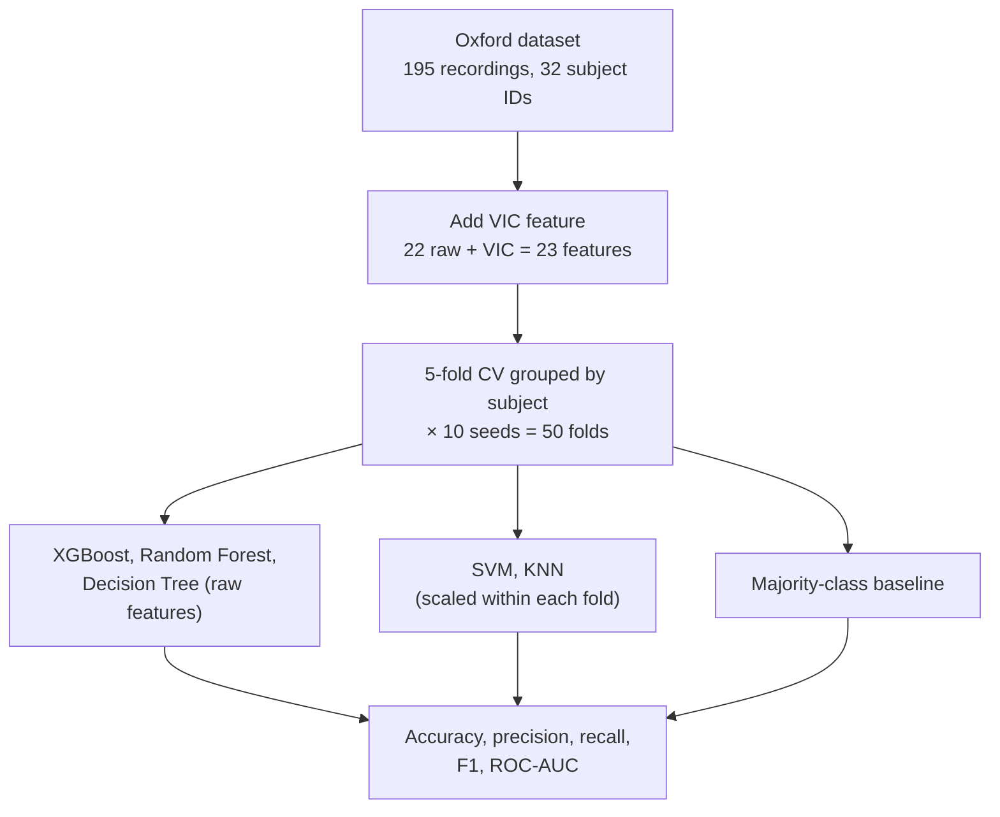

# neuroinsight-ai

**Parkinson's disease classification from voice recordings, evaluated without subject leakage.**

[](requirements.txt)
[](requirements.txt)
[](requirements.txt)
[](LICENSE)

Five classifiers are compared on the Oxford Parkinson's voice dataset using cross-validation **grouped by subject**, so no person's recordings appear in both training and validation. The project also introduces **VIC**, a single composite voice feature.

- **XGBoost** is the best of the five (F1 0.872, accuracy 0.796), but it only slightly beats a predict-everyone-has-PD baseline (F1 0.860, accuracy 0.756).
- **VIC alone** reaches 0.833 ROC-AUC in a logistic-regression test, versus 0.734 for all 22 raw features.
- **Row-level splits inflate scores on this dataset**, because each person has 6–7 recordings and a random split puts the same speaker in both train and test. Grouping by subject removes that.

> Research project only. Not a diagnostic tool.

## Pipeline



## Results

5-fold subject-grouped CV, mean ± std over 10 seeds:

| Model | Accuracy | Precision | Recall | F1 | ROC-AUC |
| :--- | :---: | :---: | :---: | :---: | :---: |
| *Baseline (predict all PD)* | *0.756 ± 0.067* | *0.756 ± 0.067* | *1.000 ± 0.000* | *0.860 ± 0.043* | *—* |
| **XGBoost** | **0.796 ± 0.098** | **0.833 ± 0.093** | 0.924 ± 0.077 | **0.872 ± 0.063** | 0.741 ± 0.034 |
| Random Forest | 0.766 ± 0.095 | 0.818 ± 0.094 | 0.902 ± 0.097 | 0.852 ± 0.064 | **0.764 ± 0.022** |
| SVM | 0.792 ± 0.091 | 0.816 ± 0.085 | 0.945 ± 0.092 | 0.871 ± 0.063 | 0.636 ± 0.033 |
| Decision Tree | 0.730 ± 0.095 | 0.818 ± 0.088 | 0.839 ± 0.106 | 0.823 ± 0.067 | 0.637 ± 0.052 |
| KNN | 0.754 ± 0.081 | 0.810 ± 0.080 | 0.891 ± 0.086 | 0.844 ± 0.055 | 0.715 ± 0.046 |

How to read this table:
- **XGBoost leads**, but its margins over the baseline are within fold-to-fold noise.
- **Random Forest ranks cases best** (highest AUC), but its default decision threshold is poorly set.
- **SVM's high F1 is misleading.** Its near-chance AUC shows the score comes from mostly predicting PD.

<p align="center">
  
  <br/>
  
  <br/>
  <em>ROC curves pool probabilities across seeds, so the Decision Tree's curve (0.723) reads higher than its per-seed average in the table (0.637).</em>
</p>

## VIC: Vocal Instability Compound

$$\text{VIC} = \log_{10}(\text{Jitter\%} \times \text{Shimmer:APQ3} \times \text{spread2} \times 1000)$$

VIC combines three kinds of voice instability: frequency (jitter), amplitude (shimmer), and pitch spread. In a standalone logistic-regression test with subject-grouped CV, VIC alone scored **0.833 ROC-AUC** against **0.734** for all 22 raw features. The 22-feature model overfits at this sample size, so this doesn't show that one feature beats twenty-two. VIC is also included as a feature in all five models above.

**Limitation:** `spread2` is missing from every external dataset tried, so VIC's full formula has only been tested on the Oxford data. Details are in [`docs/`](docs/).

## Run it

Requires Python 3.14 (versions are pinned in `requirements.txt`).

```bash
python -m venv .venv && source .venv/bin/activate
pip install -r requirements.txt
python generate_clean_assets.py      # prints the table above, regenerates both figures
```

[`notebooks/analysis.ipynb`](notebooks/analysis.ipynb) walks through the same pipeline step by step. Open it in VS Code or Jupyter.

## Repository

```
generate_clean_assets.py   full pipeline: data → VIC → grouped CV → metrics + figures
notebooks/analysis.ipynb   step-by-step walkthrough (imports the script)
data/                      Oxford dataset + two external cohorts used for validation
docs/                      VIC derivation, external validation, feature-importance checks
assets/                    figures used in this README
```

## Dataset

The data is the UCI Oxford Parkinson's Disease Detection Dataset (Little et al.). It has 195 recordings, 147 from people with PD and 48 from healthy controls. The file contains 32 subject IDs, while the UCI documentation says 31 people. Each recording has 22 acoustic features covering pitch, jitter, shimmer, noise ratios, nonlinear dynamics (D2, RPDE, DFA), and pitch entropy (spread1, spread2, PPE).

## Acknowledgments

VIC was inspired by the fPI index from *"fPI: A Novel Index for Predictive Analysis of Parkinson's Disease Using Acoustic Sound Feature"* (Gupta, Bhan & Nimsarkar, IIIT Naya Raipur). This project started from [bhanmrinal/fPI-Parkison-Analyser-using-Acoustic-Sound-Features](https://github.com/bhanmrinal/fPI-Parkison-Analyser-using-Acoustic-Sound-Features); earlier notebooks are in `legacy/`.
