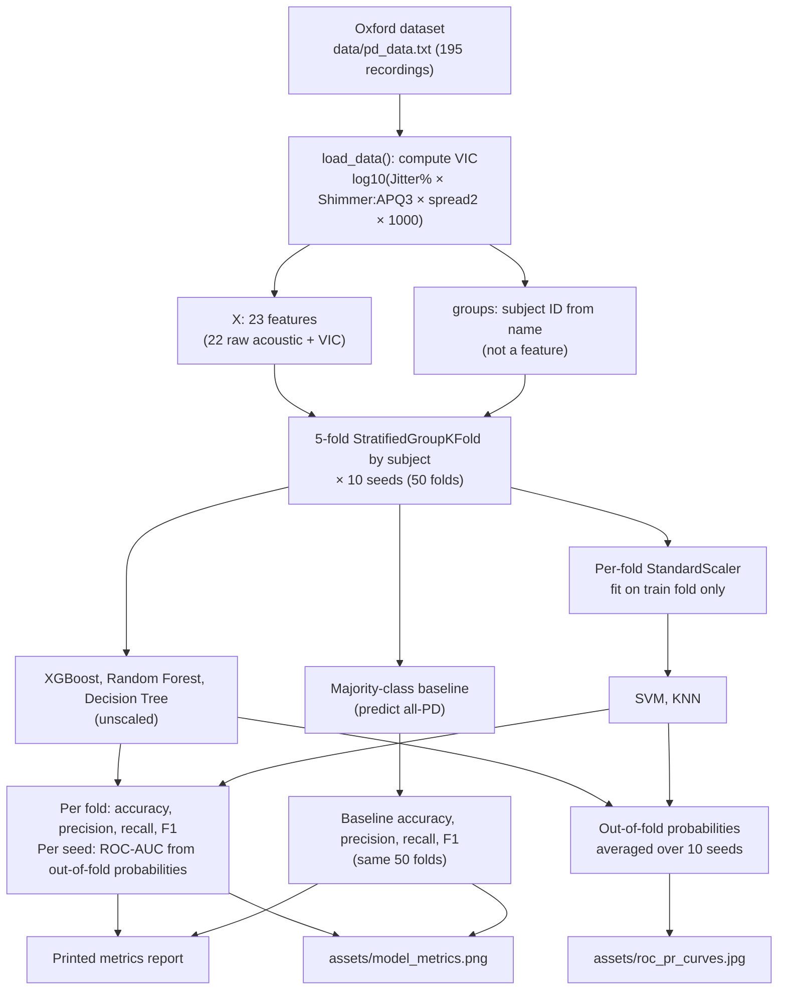
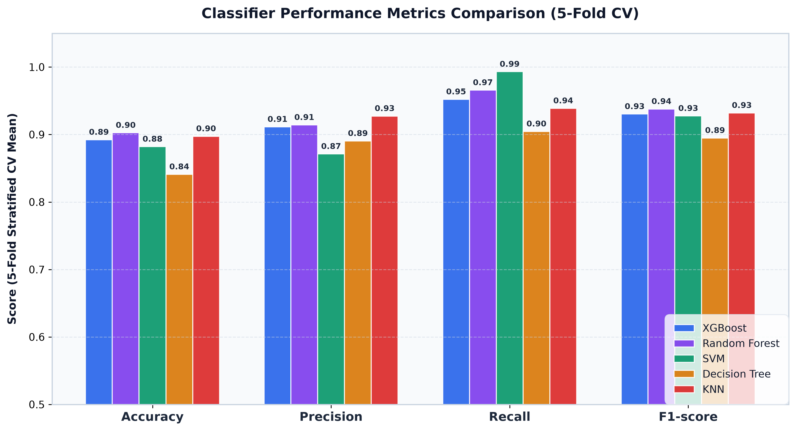
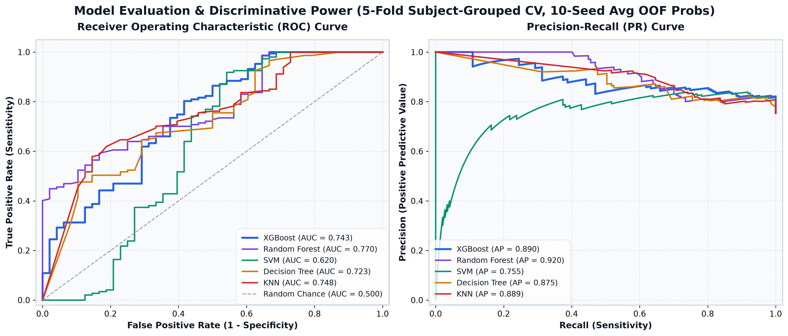

# neuroinsight-ai

### Parkinson's Disease Classification Using Vocal Acoustics and XGBoost

---

## 1. Overview

**neuroinsight-ai** is an applied machine learning research project exploring the non-invasive prediction of Parkinson's Disease using vocal acoustic biomarkers. It compares tree-based ensemble models (**Random Forest**, **XGBoost**) and other classifiers on biomedical voice measurements, and tests an independently engineered candidate feature (**VIC**, see below), all under subject-grouped cross-validation against a majority-class baseline (§8).

---

## 2. PROJECT OVERVIEW & RESEARCH OBJECTIVE

Parkinson's Disease is a progressive neurodegenerative disorder characterized by the gradual loss of dopaminergic neurons. While motor symptoms like tremors and rigidity are commonly used for clinical diagnosis, vocal impairment (dysphonia) is often one of the earliest signs of the disease, appearing years before gross motor dysfunction.

Acoustic voice analysis offers a non-invasive, objective, and low-cost biomarker for identifying subtle vocal changes. The objective of this research is to investigate the predictive capability of vocal acoustic features and to compare standard classification algorithms—including Decision Trees, Support Vector Machines, Random Forests, KNN, and XGBoost—for binary classification of healthy controls vs. subjects with Parkinson's Disease.

> [!NOTE]
> This repository represents a research-oriented predictive modeling study using voice recording datasets. It is not designed, certified, or intended for clinical medical diagnosis or diagnostic product use.

---

## 3. TECHNICAL ARCHITECTURE & WORKFLOW

The predictive modeling pipeline is structured into a modular engineering workflow, starting with dataset acquisition and moving sequentially through pre-processing, classifier training, and performance benchmarking.

### Workflow Description:
1.  **Dataset**: `data/pd_data.txt` — 195 voice recordings with 22 raw acoustic features (fundamental frequency, perturbation measures, noise ratios, nonlinear dynamics).
2.  **VIC computation**: `load_data()` computes the composite index `VIC = log10(Jitter% × Shimmer:APQ3 × spread2 × 1000)` and appends it, giving 23 model features. VIC was validated offline on this dataset (§6) and is **live in the trained pipeline** — see [Implementation Status](#implementation-status) below. The subject ID is extracted from `name` for grouping only; it is not a feature.
3.  **Cross-validation**: 5-fold `StratifiedGroupKFold` grouped by subject (all of a subject's recordings kept on the same side of each split), repeated over 10 seeds — 50 folds per model (see §8).
4.  **Per-fold scaling**: For SVM and KNN only, a `StandardScaler` is fit on the training fold and applied to the validation fold. XGBoost, Random Forest, and Decision Tree use unscaled features.
5.  **Model training**: XGBoost, Random Forest, SVM, Decision Tree, and KNN are fit on each training fold; a majority-class baseline (always predict PD) is scored on the same 50 folds.
6.  **Model evaluation**: Accuracy, precision, recall, and F1 per fold; ROC-AUC per seed from that seed's out-of-fold probabilities.
7.  **Outputs**: A printed metrics report, `assets/model_metrics.png` (fold-averaged metrics with baseline reference lines), and `assets/roc_pr_curves.jpg` (ROC and precision-recall curves from out-of-fold probabilities averaged over the 10 seeds).

---

## 4. DATASET DESCRIPTION

The analysis utilizes the UCI "Oxford Parkinson's Disease Detection Dataset" (Little et al.) — **195 voice recordings from 32 subject IDs (UCI documentation states 31 people)** (147 recordings labeled Parkinson's, 48 labeled healthy control). The features represent different dimensions of signal perturbation, noise ratios, and nonlinear dynamics:

*   **Vocal Fundamental Frequency**: Average (`MDVP:Fo(Hz)`), maximum (`MDVP:Fhi(Hz)`), and minimum (`MDVP:Flo(Hz)`) pitch.
*   **Vocal Frequency/Amplitude Perturbation**: Jitter (`MDVP:Jitter(%)`, `MDVP:RAP`, `MDVP:PPQ`) and Shimmer (`MDVP:Shimmer`, `Shimmer:APQ3`, `Shimmer:APQ5`, `MDVP:APQ`) measures, representing variations in cycle-to-cycle frequency and amplitude.
*   **Noise Measures**: Noise-to-Harmonic Ratio (`NHR`) and Harmonic-to-Noise Ratio (`HNR`), indicating voice quality degradation.
*   **Nonlinear Dynamics**: Correlation dimension (`D2`) and Recurrence Period Density Entropy (`RPDE`), measuring signal complexity and chaotic behavior.
*   **Fractal Scaling**: Detrended Fluctuation Analysis (`DFA`), measuring the self-similarity of the signal.
*   **Pitch Period Entropy**: `spread1`, `spread2`, and `PPE`, measuring the variability of fundamental frequency.

---

## 5. PREPROCESSING

For SVM and KNN, features are standardized with a `StandardScaler` fit on each training fold only; the tree models (XGBoost, Random Forest, Decision Tree) use raw features. During exploratory data analysis, high correlation was identified between frequency variation and amplitude/complexity measures, motivating the composite-index work described next.

## 6. METHODOLOGY — Vocal Instability Compound (VIC)

Inspired by the original fPI concept (see [Acknowledgments](#acknowledgments)), but built from a different, independently chosen trio of features and validated from scratch on this dataset:

$$\text{VIC} = \log_{10}(\text{Jitter\%} \times \text{Shimmer:APQ3} \times \text{spread2} \times 1000)$$

Frequency micro-instability (`Jitter%`) × amplitude micro-instability (`Shimmer:APQ3`) × frequency spread (`spread2`) — a log-product, since vocal-fold perturbation compounds cycle over cycle (multiplicative degradation), the same mathematical justification the original fPI paper used, applied to a different, independently-motivated trio.

**Headline result (Oxford dataset only):** in a standalone logistic-regression experiment (`StandardScaler → LogisticRegression`, subject-grouped 5-fold CV over 10 seeds; separate from the five-model pipeline in §8), a logistic regression on VIC alone reaches **0.833 ROC-AUC**, vs. **0.734** for a logistic regression on the full raw 22-feature set, which overfits at this sample size (about 26 training subjects per fold), so this is not a claim that one feature beats twenty-two — see [§7](#7-external-validation--limitations) for what has, and hasn't, been checked outside this dataset. Full derivation, validation tables, and comparison against two alternative candidate indices are in [`INDEX_PROPOSAL.md`](docs/INDEX_PROPOSAL.md).

### Implementation Status

**VIC is live in the trained pipeline.** `generate_clean_assets.py` computes VIC (in `load_data()`) and includes it, uncontested, in the 23-column feature matrix `X` fed to all five trained models (only `name` and `status` are dropped). The 5-fold CV metrics table in §8 below and Figures 1 and 2 are produced by this VIC-augmented pipeline — they are not a VIC-free baseline. The analysis notebook (§9) imports these same functions, so it shows VIC and reproduces the same metrics.

---

## 7. EXTERNAL VALIDATION & LIMITATIONS

VIC's full formula needs `spread2`, its third ingredient — and `spread2` is not available in either independent dataset tested (the Naranjo et al. "Replicated Acoustic Features" cohort, or the Tsanas/Little telemonitoring cohort, even though the latter comes from the **same original Oxford research group**), so VIC's complete 3-ingredient formula has never actually been computed or tested outside the Oxford dataset it was derived on. The two ingredients that could be tested (Jitter%, Shimmer:APQ3) were modestly weaker on the Naranjo cohort (subject-level correlation with PD status r=0.25 and 0.30, vs row-level 0.28 and 0.35 on Oxford) and showed no statistically significant relationship with UPDRS severity on the telemonitoring cohort (best r≈0.23, p>0.14), which is a different task (severity within an all-PD group). Because spread2 is missing, none of these comparisons is like-for-like with VIC itself, so they neither confirm nor refute it. This is a known, open limitation, not a resolved question — full details in [`VIC_EXTERNAL_VALIDATION.md`](docs/VIC_EXTERNAL_VALIDATION.md) and [`VIC_TELEMONITORING_VALIDATION.md`](docs/VIC_TELEMONITORING_VALIDATION.md).

---

## 8. MODEL DEVELOPMENT & EVALUATION

Multiple machine learning classifiers were evaluated under 5-fold **subject-grouped** stratified cross-validation (splits keep every recording from a given subject on the same side of the fold, so the model is never validated on a subject it has already seen), averaged over **10 random seeds** (50 folds total per model). A **majority-class baseline** (always predict "has PD," a fold-averaged ~75.6% of recordings across the 50 evaluation folds) is included as the row every model needs to beat to be doing more than exploiting the class imbalance.

### 5-Fold Subject-Grouped CV Metrics Summary (10-Seed Mean ± Std)

| Model | Accuracy | Precision | Recall | F1-score | AUC |
| :--- | :---: | :---: | :---: | :---: | :---: |
| *Majority baseline (predict all-PD)* | *0.756 ± 0.067* | *0.756 ± 0.067* | *1.000 ± 0.000* | *0.860 ± 0.043* | *—* |
| **XGBoost** | **0.796 ± 0.098** | **0.833 ± 0.093** | 0.924 ± 0.077 | **0.872 ± 0.063** | 0.741 ± 0.034 |
| Random Forest | 0.766 ± 0.095 | 0.818 ± 0.094 | 0.902 ± 0.097 | 0.852 ± 0.064 | **0.764 ± 0.022** |
| SVM | 0.792 ± 0.091 | 0.816 ± 0.085 | 0.945 ± 0.092 | 0.871 ± 0.063 | 0.636 ± 0.033 |
| Decision Tree | 0.730 ± 0.095 | 0.818 ± 0.088 | 0.839 ± 0.106 | 0.823 ± 0.067 | 0.637 ± 0.052 |
| KNN | 0.754 ± 0.081 | 0.810 ± 0.080 | 0.891 ± 0.086 | 0.844 ± 0.055 | 0.715 ± 0.046 |

± is std over the 50 folds, except AUC (std over 10 per-seed AUC values, pooled out-of-fold probabilities). XGBoost is the best-performing of the five on accuracy, precision, *and* F1 and edges the majority baseline on each, but every margin is comparable to or smaller than the fold-to-fold std and no paired fold-level test was run; Random Forest has the best raw AUC (0.764) but is threshold-miscalibrated (F1 below baseline); SVM's near-chance AUC (0.636) means its high F1 isn't backed by learned separation. See [§10](#10-research-insights) for per-model detail.

This table, along with the two images below, is produced reproducibly by [`generate_clean_assets.py`](generate_clean_assets.py) — run it directly to regenerate these numbers and figures.

### Performance Visualization & Evaluation Plots

  
  
<em>Figure 1: Metric comparisons across ML architectures. Dashed line = majority-class baseline for each metric.</em>

  
  
<em>Figure 2: ROC and Precision-Recall curves, from probabilities pooled across all 10 seeds. The Decision Tree AUC shown here (0.723) is inflated relative to its true per-seed average (0.637); treat the table's 0.637 as representative.</em>

---

## 9. NOTEBOOK

[`notebooks/analysis.ipynb`](notebooks/analysis.ipynb) walks through the pipeline step by step: dataset summary (195 recordings, 32 subject IDs, class balance), the VIC formula, 5-fold subject-grouped CV over 10 seeds, the §8 metrics table including the majority baseline, and both figures. It imports its functions from [`generate_clean_assets.py`](generate_clean_assets.py) rather than re-implementing them, and checks its table against §8.

---

## 10. RESEARCH INSIGHTS

*   **XGBoost is the best-performing of the five classifiers.** F1 (0.872) and precision (0.833) edge the baseline, with margins inside the fold-to-fold spread (no paired fold-level test run), and some ranking ability behind them — AUC 0.741, second-highest of the five. It's the model worth building on.
*   **Random Forest has the best raw discriminative ranking (AUC 0.764) but its default threshold is miscalibrated** — F1 (0.852) lands below the 0.860 baseline despite the separability being there. Threshold tuning (e.g. `CalibratedClassifierCV`) is the natural next step.
*   **SVM shows limited genuine signal once subject-level leakage is removed.** AUC 0.636 — near-chance, lowest of the five. Its high recall/F1 reflects majority-class collapse in 22% of folds, not learned discrimination.
*   **Decision Tree and KNN sit at or below the majority baseline on F1** (0.823 and 0.844 vs. 0.860) and don't earn a place over XGBoost on these numbers.
*   **Feature importance (leak-free permutation/drop-column testing):** the `spread1`/`PPE` cluster and `D2` hold up as genuine signal; `Shimmer` and `RPDE` do not, despite looking important under gain-based ranking alone. Full ranked tables and methodology in [`FEATURE_IMPORTANCE_VALIDATION.md`](docs/FEATURE_IMPORTANCE_VALIDATION.md).
*   **Composite-Feature Value (Oxford dataset only)**: in the standalone logistic-regression comparison in §6 (not the five-model pipeline), a logistic regression on VIC alone beats one on the full 22-feature raw set under subject-grouped cross-validation on the dataset it was derived on (0.833 vs. 0.734 ROC-AUC) — but VIC's full formula is untested on independent data, and its two testable ingredients were modestly weaker on one external cohort and showed no significant severity relationship on the other (§7). Read as a promising, unresolved research direction, not a proven generalizable biomarker.

---

## 11. FUTURE IMPROVEMENTS

*   **Resolving the External Validation Gap**: `spread2` is unavailable in every external dataset checked so far (§7); finding or re-deriving a comparable nonlinear frequency-spread measure on independent data is the clearest path to actually testing VIC's full formula outside Oxford.
*   **Deeper Feature Engineering**: Formulating and testing alternative perturbation indices beyond VIC, CCC, and NRR (see [`INDEX_PROPOSAL.md`](docs/INDEX_PROPOSAL.md)).
*   **Model Explainability Expansion**: Implementing SHAP (SHapley Additive exPlanations) or LIME to mathematically map the contribution of each vocal feature in individual predictions.
*   **Longitudinal Studies**: Exploring vocal changes over time using clinical datasets to assess prediction stability across different stages of degeneration.

---

## Acknowledgments
VIC was inspired by the fPI index from *"fPI: A Novel Index for Predictive Analysis of Parkinson's Disease Using Acoustic Sound Feature"* (Gupta, Bhan & Nimsarkar, IIIT Naya Raipur). This project started from [bhanmrinal/fPI-Parkison-Analyser-using-Acoustic-Sound-Features](https://github.com/bhanmrinal/fPI-Parkison-Analyser-using-Acoustic-Sound-Features); earlier notebooks are in `legacy/`.
